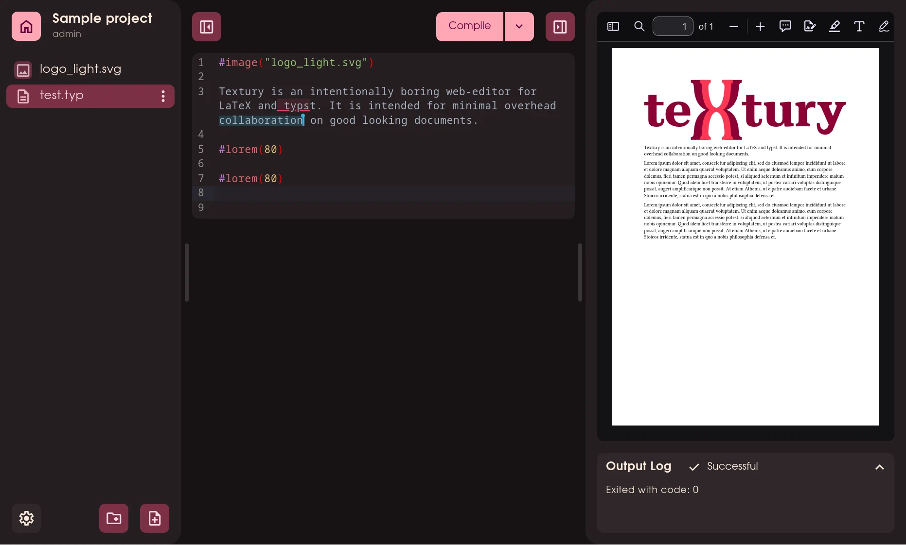
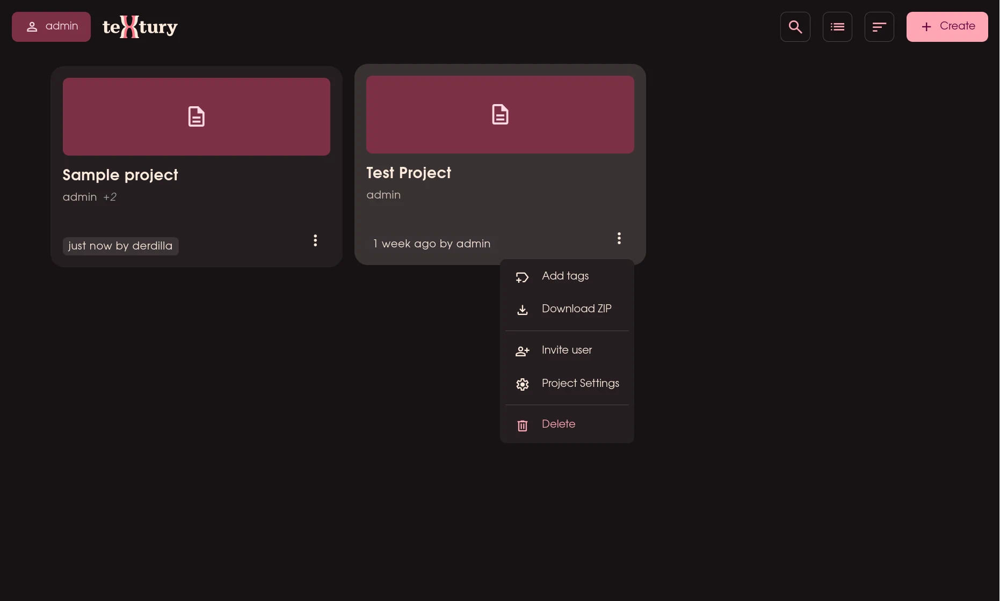

> [!WARNING]
> This is still in early development. Breaking changes and bugs are to be expected on every commit.
> 
> It is functional for everyday use – if you are fine with getting your hands dirty. It may not be secure and changes may be lost, so keep backups.

  
  <h1></img></h1>

  _Textury is an intentionally boring web-editor for $\LaTeX$ and [typst](https://github.com/typst/typst). It is intended for minimal overhead collaboration on good looking documents._

### Features

- Create multi-file projects
- Collaborate on text files
- Compile LaTeX and Typst documents
- Be resource efficient to self host
- Invite users via link
- Invite people without account

### Impressions

  
  

### Why not use X

- overleaf is heavy to self host and doesn't support typst
- git repositories are great, but we get no live collaboration. Most non-programmers don't know how to use them
- google docs, Nextcloud/MS office, ect. documents are just not rigorous enough

## Deployment

We don't yet provide builds. To run this anyways:
1. `git clone https://codeberg.org/derdilla/textury.git`
2. `cd textury && docker compose up --build`
3. Go to http://localhost:8001
     - an initial registration token is in the server logs

For more elaborate setup, you may want to manually:
- compile the server: `cargo build --bin server --release`
- Install bubblewrap for making compilations secure
- compile the UI: `cd frontend && pnpm build`
- Copy `textury.sample.toml` to `textury.toml`
- start the server
- Serve `frontend/dist` from the same domain, like nginx.prod.config

## License

This software is licensed as [EUPL version 1.2](https://eupl.eu/). You can find a copy at [LICENSE.txt](LICENSE.txt) and translated version at eupl.eu (e. g. [german](https://eupl.eu/1.2/de/)).

Please note, that you may not use Textury name and logo except for referring to this tool. We ask that you change the name, logo, and favicon of public deployments to avoid confusion. You should use the name, and at your own discretion logo, to link to this repository.
